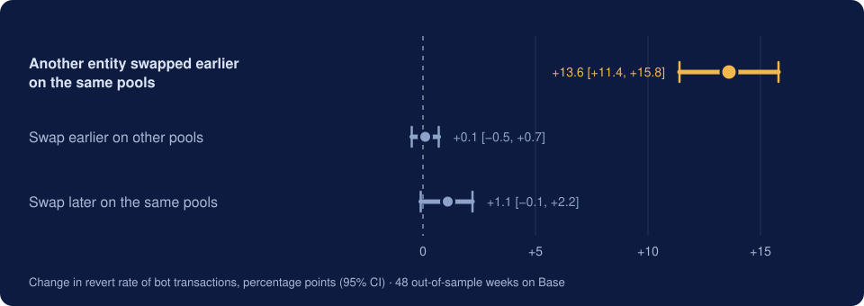

# Keneth Huerta

**Mexico City · Data analysis & statistics · ESCOM–IPN**

Computer Systems Engineering student, 3rd semester. I work on quantitative analysis: turning noisy data (official surveys, blockchain transactions, physics simulations) into estimates with confidence intervals, checked out of sample, with open code and data.

## Recent work

**[Failed arbitrage attempts on Base](https://github.com/Keneth-Huerta/flashbots-revert-classifier)** · Rust, Python · [preprint](https://doi.org/10.5281/zenodo.23610470)

Preregistered observational study of why arbitrage bots' transactions fail on Base and other OP-stack chains. In weeks not used to form the hypotheses, the revert rate is 13.6 points higher (95% CI 11.4 to 15.8) when another entity already swapped earlier in the block on the same pools. The study makes no causal claim. Code and data are open, with DOIs.

  

**INEGI–ANTAD Datathon 2026** · Python, statsmodels

Representative of IPN at the 3rd edition (ESCOM–ESCA team, one of 10 universities). Analysis of ENDUTIH 2025 microdata with survey weights and design-based standard errors; the estimates reproduce INEGI's official figures and put the number of connected adults who do not shop online at 45.9 million. I found a measurement error: the survey's digital-transactions question also counts paying for the purchase itself. Correcting it cut the association from +25 to +11.6 percentage points; the preregistered hypotheses held in the 2024 edition.

**SustainaFlow AI** · FastAPI, GCP, TimescaleDB, Docker

Built in 3 days by a team of 4 at Talent Land 2026. I wrote the backend of a data pipeline that turns CFDI invoices into emissions estimates for small businesses: Facturapi webhook with idempotency, Pub/Sub queue, Cloud Run deployment, and Gemini classification validated with Pydantic, with a deterministic fallback when the model fails.

**MagRecon-AI: electromagnetic inverse design** · Python, Numba, scikit-learn

Simulation pipeline (~100k configurations per case), surrogate models (ExtraTrees, DNN) and Bayesian optimization re-checked on the physics solver. On the TEAM 35 benchmark the surrogates reach R² = 0.96 on a random split but 0.65 on an out-of-distribution geometric split; I documented that generalization limit.

## Education

- **Escuela Superior de Cómputo (ESCOM), IPN** · B.Sc. Computer Systems Engineering, 2025–2029 (3rd semester), GPA 9.0/10
- **CECyT 3 "Estanislao Ramírez Ruiz", IPN** · Computer Technician, 2022–2025, GPA 8.7/10

## Publications and talks

- **Failed Arbitrage Attempts on Base: Bot Competition or Isolated Search?** Preprint, Zenodo, 2026. [doi:10.5281/zenodo.23610470](https://doi.org/10.5281/zenodo.23610470)
- **Dataset** for the study above. Zenodo, 2026. [doi:10.5281/zenodo.23549452](https://doi.org/10.5281/zenodo.23549452)
- **¿Basura o guerra de bots? Disección de transacciones fallidas en Base L2 con Rust.** Talk, Mexico Tech Week 2026, Main Stage, Mexico City.

## Recognition

- Finalist, Capital One challenge, Talent Land Hackathon 2026.
- BEIFI research scholar (IPN), 2024.

## Tools

- **Languages:** Python, Rust, C/C++, Java, Kotlin, JavaScript/TypeScript, SQL
- **Data:** pandas, NumPy, statsmodels, scikit-learn, TensorFlow; complex survey designs, bootstrap, preregistration
- **Data engineering and cloud:** FastAPI, PostgreSQL/TimescaleDB, Redis, Docker, GCP (Cloud Run, Pub/Sub), CI/CD, Linux
- **Other:** CUDA/Numba, Next.js, Android (Kotlin/Java), Git, LaTeX

  

**Spoken languages:** Spanish (native), English (B2)

  
  

